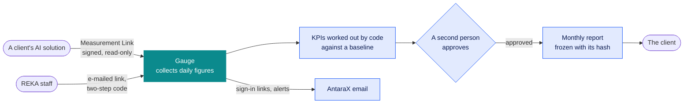

<p align="center"></p>

<p align="center">


</p>

<p align="center"><b>Shows whether each AI solution REKA built for a client is working, being used, and delivering the result the client was promised.</b><br>For REKA's project managers, analysts and operations staff, and, through reviewed monthly reports, the clients they serve.</p>

<p align="center"><a href="docs/PRD.md">Product requirements</a> · <a href="mocks/README.md">Clickable mock</a> · <a href="docs/DEPLOY.md">Deploying</a> · <a href="integrations/measure/README.md">For a solution's developer</a> · <a href="docs/PRD.md#20-open-decisions">Open decisions</a> · <a href="https://github.com/haziqfaris/AntaraX-Dashboard-kit">AXLE standard</a></p>

> [!IMPORTANT]
> **Internal, and not deployed yet.** Status, 17 Oct 2026: lean version 1 is built ([docs/GO_LIVE_ENGINEERING.md](docs/GO_LIVE_ENGINEERING.md)): connect an application, collect its daily figures, three KPIs against an approved baseline, approvals by a second person, six pages, a monthly report frozen with its hash. Tested end to end against the kit's example application. Not deployed yet: see [docs/DEPLOY.md](docs/DEPLOY.md). It will live at `https://gauge.antarax.ai`. The clickable mock ([mocks/](mocks/README.md)) remains the roadmap; every client, person and figure in it is invented. Inside the code and on screen it is still AXLE · Outcomes until those are renamed.

## What it is

Gauge, formerly "Performance Intelligence (working name)" and "Ripple Monitoring", is REKA's console for measuring what its client AI solutions actually deliver: whether each is healthy and used, how it performs, and what business outcome it produces against an agreed baseline. It starts inside REKA, supporting the Managed AI service's "we watch it, we improve it" promise, and is built so it can graduate to an AntaraX product later.

Today each client engagement proves its worth with its own spreadsheet, slide or one-off dashboard, if it proves it at all. Gauge connects to every client solution through one small, read-only link, collects its daily figures, works out the agreed measures against a baseline, and has a second person approve them before a client sees anything.

The numbers are worked out by code, never by AI, and a missing day is shown as a gap, never a zero. Gauge measures outcomes; how each product runs day to day (usage, health, capacity, cost) is watched by that product's own AXLE.

## Who it is for

| Person | What they get |
|---|---|
| **REKA project manager** | Whether their solutions are delivering; agreed KPIs and baselines; approving reports |
| **REKA analyst** | Mapping metrics, building measurement plans, checking baselines, looking into anything odd |
| **REKA operations** (on call) | Failing collections and unhealthy solutions first, on a phone if needed |
| **REKA leadership** | Portfolio health and outcome trends |
| **A client solution's developer** | A clear contract, a kit and a contract test, in [integrations/measure/](integrations/measure/README.md) |
| **A client sponsor** | A clear, honest monthly report of what changed, reviewed by REKA. No sign-in to the console |

Roles in full are in [PRD §4](docs/PRD.md#4-people-roles-and-access).

## What it does

What version 1 does today, in this repository:

| Feature | What it means for you |
|---|---|
| **Track an application** | Connect a client solution through its Measurement Link, or an AntaraX product or a spreadsheet |
| **Daily figures** | Gauge collects each application's daily figures on a schedule and says when a link stops answering |
| **KPIs against a baseline** | Three KPIs worked out by code against a baseline someone approved |
| **Two people, every time** | A second person approves baselines and reports, because "hours saved" is a claim made to a client |
| **Monthly report** | A report frozen with its hash, so what the client received can be checked later |
| **Separation between organisations** | Enforced in the database and tested: one client never sees another's figures |
| **Sign-in without passwords** | An e-mailed link, then a two-step code |

Everything else in the PRD and the mock waits until a pilot shows it is needed.

## How it works



**How it fits with the rest of AntaraX.**

| Repository | What this product takes from it |
|---|---|
| `haziqfaris/AntaraX-brand-kit` | Names, claims rules, type, colour, the AI sparkle, report conventions. The kit wins where they disagree |
| `haziqfaris/AntaraX-Dashboard-kit` | The AXLE standard (`axle/SPEC.md`): shell, roles, "never a false zero", attention first, audit |
| `haziqfaris/antarax-api` | The API contract (paths, names, lists, errors, money, time), AXLE Link signing and the registry |
| `haziqfaris/antarax-ai` | Positioning: Managed AI, the REKA and AntaraX boundary, the claims rules for anything public |

The Measurement Link and its kit come from Lapisan ([haziqfaris/antarax-api](https://github.com/haziqfaris/antarax-api), docs/14 and decision 0013), copied into [`vendor/lapisan/`](vendor/lapisan). Gauge sends its e-mail through AntaraX email as `Gauge <gauge@mail.antarax.ai>` ([docs/DEPLOY.md](docs/DEPLOY.md), step 4). It follows the [AXLE standard](https://github.com/haziqfaris/AntaraX-Dashboard-kit) so REKA's staff find it familiar, and keeps working without AXLE or AX Frame ([PRD §5](docs/PRD.md#5-principles)).

## What's inside this repository

**Documents**

| Path | What it is |
|---|---|
| [docs/PRD.md](docs/PRD.md) | The product requirements: goals, roles, domain model, numbered requirements, the measurement interface, methodology, AI and approval gates, screens, security, stack, release plan, risks and open decisions |
| [docs/MASTER_BRIEF.md](docs/MASTER_BRIEF.md) | The master brief the PRD is built from (version 0.1, 15 Oct 2026), unchanged |
| [mocks/](mocks/README.md) | A clickable product mock: sign-in, first-run setup, connecting a first project, and an established workspace with example data |
| [integrations/measure/](integrations/measure/README.md) | The Measurement Link integration pack for a solution's developer: the agent instruction, the contract test, OpenAPI, examples, signature test vectors and a Python signer. Generated parts come from antarax-api |
| [docs/workshop/PHASE_0_DECISIONS.md](docs/workshop/PHASE_0_DECISIONS.md) | The fifteen open decisions for the design workshop, each with a recommendation, what backs it and what it blocks |
| [docs/research/USABILITY_TEST_PLAN.md](docs/research/USABILITY_TEST_PLAN.md) | Five moderated sessions with REKA project managers on the mock: questions, tasks, script and analysis |
| [docs/GO_LIVE_ENGINEERING.md](docs/GO_LIVE_ENGINEERING.md) | Lean version 1: what is built, what is not and why, the decisions that block code, and the tasks |
| [docs/DEPLOY.md](docs/DEPLOY.md) | How to put the console on Vercel with its database on Supabase |

**Code**

| Code | What it is |
|---|---|
| [`app/`](app) | The console (Next.js): sign-in by e-mailed link then a two-step code, Applications and tracking one, an application's page, Results, Approvals, Reports, Jobs, the developer link, the scheduled jobs |
| [`domain/`](domain) | Pure logic: the KPI engine, link states, the spreadsheet parser, the developer prompt |
| [`lib/`](lib) | Database access inside a scope, sealing, audit, sign-in, and the services the pages call |
| [`db/migrations/`](db/migrations) | The schema, row-level security and the append-only audit |
| [`vendor/lapisan/`](vendor/lapisan) | The Measurement Link kit, copied from antarax-api; never edited here |
| [`scripts/`](scripts) | The local database, adding staff, running a job, the example application, backups, the vendor sync, e-mail colours and the browser tests |
| [`tests/`](tests) | Unit, database and browser end-to-end tests |
| [`.env.example`](.env.example) | Every setting the console reads, with what each is for |

## How to use it

### Just look

Gauge is not deployed yet, so the quickest look is the clickable mock: open `mocks/index.html` in a browser (no build step), or `python3 -m http.server -d mocks` and visit `http://localhost:8000`. Every organisation, person and figure in it is invented. Inside, choose **Watch the guided demo** ([mocks/README.md](mocks/README.md)).

### Run it on your computer

You need Node.js 22 or later and npm. `npm run db:local` starts Postgres 16 for you.

```bash
npm install
npm run db:local          # Postgres 16 on :54329; prints the two URLs for .env.local (see .env.example)
npm run staff:add -- --email you@reka.example --name "Your Name" --role approver
npm run dev               # http://localhost:3200; without Resend, sign-in links print in this terminal
AX_MEASURE_KEY=<the key the console shows> npm run example-link   # a stand-in application on :4010
```

1. Install, start the local database, and put the two URLs it prints into `.env.local` (see [.env.example](.env.example)).
2. Add yourself as staff, replacing the example e-mail and name with your own.
3. Start the console and open `http://localhost:3200`. Without Resend, sign-in links print in the terminal.
4. Track an application in the console, then start the stand-in application with the key the console shows you.

### Everyday tasks

| Check | Command |
|---|---|
| Typecheck, unit, separation and the whole loop against real Postgres | `npm run check` |
| The loop in a browser, phones and accessibility | `bash scripts/e2e.sh` |

There is no hosted CI (no GitHub Actions): run both before pushing. Each Vercel deployment runs the typecheck and unit tests before it builds (`vercel-build`), and a failure stops the deployment.

| Command | What it does |
|---|---|
| `npm run dev` | Runs the console on `http://localhost:3200` |
| `npm run db:local` | Starts Postgres 16 on port 54329 and prints the URLs for `.env.local` |
| `npm run db:migrate` | Applies the migrations in `db/migrations/` |
| `npm run staff:add` | Adds a staff member (`--email`, `--name`, `--role`) |
| `npm run jobs:run -- nightly` | Runs a scheduled job by hand: `nightly`, `health` or `mail` |
| `npm run example-link` | Starts a stand-in application with a Measurement Link on port 4010 |
| `npm run backup` | A backup you can restore: `pg_dump` to `BACKUP_DIR` (default `./backups`), named by time |
| `npm run vendor:sync` | Copies the Measurement Link kit from antarax-api into `vendor/lapisan/` |
| `npm run mail:colours` | Regenerates the e-mail colours from `app/axle-tokens.css` |

## Documentation map

**Read in this order**

1. The PRD's [§1 Summary](docs/PRD.md#1-summary) and [§5 Principles](docs/PRD.md#5-principles).
2. Open the mock: `mocks/index.html` in a browser (no build step), or `python3 -m http.server -d mocks` and visit `http://localhost:8000`.
3. The PRD's [§20 Open decisions](docs/PRD.md#20-open-decisions): what the owner needs to settle before Phase 1.

**How it works**

| Doc | What it holds |
|---|---|
| [PRD §6 Where it sits](docs/PRD.md#6-where-it-sits-reka-antarax-axle-and-frame) | REKA or AntaraX, the name, AXLE and AXLE Central, AX Frame, who measures what |
| [PRD §9 The measurement interface](docs/PRD.md#9-the-measurement-interface-measurement-link) | The Measurement Link, as Gauge uses it |
| [PRD §10 Methodology](docs/PRD.md#10-measurement-and-impact-methodology) | How measures, baselines and impact are worked out |
| [integrations/measure/README.md](integrations/measure/README.md) | The integration pack for a solution's developer |

**Decisions and plans**

| Doc | What it holds |
|---|---|
| [PRD §20 Open decisions](docs/PRD.md#20-open-decisions) | What is decided and what is still open |
| [docs/workshop/PHASE_0_DECISIONS.md](docs/workshop/PHASE_0_DECISIONS.md) | Each open decision with a recommendation |
| [docs/GO_LIVE_ENGINEERING.md](docs/GO_LIVE_ENGINEERING.md) | Lean version 1 and its tasks |
| [docs/research/USABILITY_TEST_PLAN.md](docs/research/USABILITY_TEST_PLAN.md) | The usability test plan for the mock |

**Operations**

| Doc | What it holds |
|---|---|
| [docs/DEPLOY.md](docs/DEPLOY.md) | Vercel, Supabase, the console's own login, e-mail, secrets, backups |
| [.env.example](.env.example) | Every setting, with what it is for |

## Name

**Gauge** (Ripple Gauge in full; Gauge for short), decided by the owner on 18 Oct 2026, at `gauge.antarax.ai`. "Performance Intelligence" was the brief's working name, and "Outcomes" the area inside AXLE the PRD proposed; see [PRD §6.2](docs/PRD.md#62-name). The repository keeps its name.

## For developers and agents

- **Rules:** [AGENTS.md](AGENTS.md) and [CLAUDE.md](CLAUDE.md). Read [docs/PRD.md](docs/PRD.md) before changing anything, and cite requirement ids (FR-…, NFR-…) in commits and pull requests.
- **Before pushing:** `npm run check`, and `bash scripts/e2e.sh` for anything a person sees. There is no GitHub Actions; don't add a workflow.
- **Never edit** `vendor/lapisan/` (sync it with `npm run vendor:sync`) or [docs/MASTER_BRIEF.md](docs/MASTER_BRIEF.md) (record changes in the PRD).
- **Never resolve an open decision silently** (PRD §20). If work needs one, say so.
- **Deploying:** [docs/DEPLOY.md](docs/DEPLOY.md).

## Help and contact

- **Inside REKA:** raise questions about Gauge, its requirements or its open decisions with the owner.
- **A client solution's developer:** start with [integrations/measure/README.md](integrations/measure/README.md) and run its contract test before handing over.
- **E-mail from Gauge** replies to `support@go.antarax.ai`.

<p align="center"></p>
<p align="center"><sub>AntaraX is the product line of REKA Inisiatif Sdn Bhd · <a href="https://antarax.ai">antarax.ai</a> · <a href="https://reka.re">reka.re</a><br>Private and proprietary. © 2026 REKA Inisiatif Sdn Bhd. All rights reserved. Owned by REKA Inisiatif Sdn Bhd. · Last updated 26 October 2026</sub></p>
