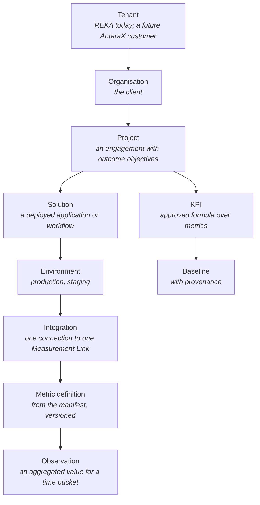
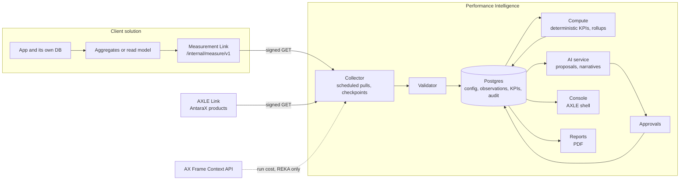

# Performance Intelligence: product requirements

**Version 0.2, draft, 15 Oct 2026.** 0.2 adds first use and onboarding (§8.12, §12.3) and moves the console to the light AntaraX look (§12.1). Working name throughout. Owner: Muhammad Haziq Faris (Founder). Status: for review at the next design workshop.

| | |
|---|---|
| **Source brief** | [MASTER_BRIEF.md](MASTER_BRIEF.md), version 0.1, 15 Oct 2026 |
| **Aligned with** | AntaraX brand kit 1.4 (`haziqfaris/AntaraX-brand-kit`), AXLE standard 0.1 (`haziqfaris/AntaraX-Dashboard-kit/axle/SPEC.md`), AntaraX API framework v0.6.0 (`haziqfaris/antarax-api`), website strategy (`haziqfaris/antarax-ai/docs/strategy/`) |
| **Mocks** | [../mocks/](../mocks/README.md): a clickable product, from sign-in through first project to the example workspace |
| **Decision rules** | Where this PRD and the brief disagree, the PRD records why and lists the point in [§20 Open decisions](#20-open-decisions). Nothing here is decided until the owner signs it off. Brand decisions are recorded in the brand kit, not here. |

**How to read this document.** §1 to §6 say what we are building and why. §7 to §12 are the requirements, numbered so tickets and tests can cite them. §13 to §17 cover the platform underneath. §18 to §21 cover delivery, risk and open decisions. Requirements use **must**, **should** and **may** as in the AXLE standard.

---

## Contents

1. [Summary](#1-summary)
2. [Problem and context](#2-problem-and-context)
3. [Goals, non-goals and success measures](#3-goals-non-goals-and-success-measures)
4. [People, roles and access](#4-people-roles-and-access)
5. [Principles](#5-principles)
6. [Where it sits: REKA, AntaraX, AXLE and Frame](#6-where-it-sits-reka-antarax-axle-and-frame)
7. [Domain model](#7-domain-model)
8. [Functional requirements](#8-functional-requirements)
9. [The measurement interface (Measurement Link)](#9-the-measurement-interface-measurement-link)
10. [Measurement and impact methodology](#10-measurement-and-impact-methodology)
11. [AI assistance and approval gates](#11-ai-assistance-and-approval-gates)
12. [Experience and screens](#12-experience-and-screens)
13. [Non-functional requirements](#13-non-functional-requirements)
14. [Security, privacy and governance](#14-security-privacy-and-governance)
15. [Architecture and stack](#15-architecture-and-stack)
16. [Data retention](#16-data-retention)
17. [Measuring the platform itself](#17-measuring-the-platform-itself)
18. [Release plan](#18-release-plan)
19. [Risks](#19-risks)
20. [Open decisions](#20-open-decisions)
21. [Appendices](#21-appendices)

---

## 1 Summary

REKA builds custom AI solutions for clients and, through Managed AI, promises to **watch them and improve them** after launch. Today each engagement proves its worth with its own spreadsheet, slide or one-off dashboard, if it proves it at all.

Performance Intelligence is one internal REKA console that:

1. **connects** to every client solution through one small, read-only, versioned measurement interface, without changing how the solution is built;
2. **collects** aggregated metrics on a schedule and keeps their provenance, freshness and quality;
3. **computes** approved KPIs and impact against agreed baselines, deterministically;
4. **shows** health, adoption, operational performance, business impact and (for REKA only) commercial performance, at solution, project, organisation and portfolio level;
5. **uses AI** to propose KPIs, baselines, layouts and narratives, which a person approves before anything is published;
6. **delivers** a reviewed report to the client, as a PDF first.

It starts as a REKA tool, built to the AXLE standard so staff find it familiar. Its data model is multi-tenant from day one so it can later graduate to an AntaraX product, under the graduation rule in the brand kit (01).

> **One sentence for the team:** standardise the interface, not the client application; measure outcomes, not just activity; compute numbers with code and explain them with AI; label every estimate; and publish nothing a person has not approved.

## 2 Problem and context

### 2.1 What goes wrong today

| Problem | Effect |
|---|---|
| Every engagement measures itself differently, or not at all | REKA cannot compare projects, spot a failing one early, or show the portfolio's value |
| Impact claims rely on memory and slides | Clients cannot verify them, and the brand kit (03) forbids making them without evidence |
| A bespoke dashboard per client | Costly to build, drifts out of date, and nobody maintains it after handover |
| Health, usage and outcomes live in different places | A solution can be "up" while nobody uses it, or busy while saving nothing |
| No baselines recorded before go-live | "Hours saved" cannot be computed after the fact |

### 2.2 Why now

- **Managed AI already promises it.** The brand kit defines Managed AI as "REKA hosts, watches, improves and keeps the AI reliable on one subscription." The steps "we watch it, we improve it" need a tool behind them.
- **Proof is the bottleneck on growth.** The website rules (antarax-ai playbook §24.5, §27) forbid outcome figures that are not evidenced. Measured, client-approved outcomes are the only honest route to case studies.
- **The plumbing half exists.** AXLE Link already gives `health` and `usage` for AntaraX products. The AXLE standard already sets the console look, roles, audit and "never a false zero". This product extends that work; it does not invent a parallel stack.

### 2.3 What the brief asked for

The brief's confirmed decisions (its §2) are adopted as requirements. Its proposed engineering defaults are adopted where they match the AntaraX API framework, and changed where they do not; each change is listed in [§9.8](#98-differences-from-the-brief).

## 3 Goals, non-goals and success measures

### 3.1 Goals

| # | Goal |
|---|---|
| G1 | Any REKA-built client solution can be connected in under one working day of client-side engineering, without changing its domain model |
| G2 | Staff can see, for every live solution, whether it is healthy, used, performing and delivering the agreed outcome, with the freshness of each figure |
| G3 | Every published outcome figure traces back to a source metric, a formula version, a baseline with provenance, and an approval |
| G4 | The same widget library renders every solution, by configuration alone |
| G5 | A monthly or quarterly client report is drafted automatically and reviewed by a person before it goes out |
| G6 | The data model and contract allow AntaraX to offer this to third parties later without a rewrite |

### 3.2 Non-goals for the MVP

From the brief §3, and confirmed:

- Replacing a client's own operational dashboards.
- Being an observability or APM stack (no traces, logs or per-request metrics). Health comes from the solution's own `health` endpoint and, where present, AXLE Link.
- Pulling raw client records, documents or personal data.
- Publishing a KPI, baseline or claim without a person's approval.
- Customer-facing billing, subscriptions, self-service onboarding or a marketplace.
- General-purpose BI authoring (no free-form query builder).
- A separate client login. Clients get a report, and later an embed.

### 3.3 How we will know it works

These are targets for the pilot, not claims. They are reviewed at the end of Phase 1.

| Measure | Target for the pilot |
|---|---|
| Pilot solutions connected and collecting | 2 of 2, materially different (brief §15) |
| Approved KPIs per pilot solution | at least 3, with baseline provenance |
| Client-side engineering time to connect | at most 1 day each, logged |
| Collection freshness | 95% of scheduled pulls succeed within their window over 30 days |
| Report drafting time for staff | under 1 hour from draft to approved, logged |
| Figures shown without provenance | 0 (tested) |
| Stale or failed sources shown as zero | 0 (tested) |

## 4 People, roles and access

### 4.1 Who uses it

| Person | Where they work | What they need |
|---|---|---|
| **REKA project manager** | REKA, owns client delivery | Know if their solutions are delivering, agree KPIs and baselines with the client, approve reports |
| **REKA analyst** | REKA, data and measurement | Map metrics, build measurement plans, check baselines, investigate anomalies |
| **REKA operations** (on call) | REKA, keeps solutions running | See failing collections and unhealthy solutions first, on a phone if needed |
| **REKA leadership** | REKA, portfolio and renewals | Portfolio health, outcome trends, renewal risk, internal cost and margin |
| **Client engineer** | Client or REKA delivery team | A clear contract, a manifest generator, contract tests, a quick connection check |
| **Client sponsor** (reader only) | Client | A clear, honest report of what changed, with evidence and caveats. No login in the MVP |

### 4.2 Roles

The brief lists platform admin, REKA operations, project manager, analyst and client viewer. The AXLE standard (§4.2) already defines one staff ladder used across REKA consoles. To keep "one console, many products", this PRD maps the brief's roles onto that ladder plus **rights**:

| Brief role | AXLE rung | Rights on top | Can |
|---|---|---|---|
| (anyone in REKA who reads) | **Viewer** | | Read every dashboard and catalog; commercial figures show "–" and "Needs the Commercial right" |
| Analyst | **Support** | **Measurement** | Plus: draft measurement plans, propose KPI and baseline changes, add notes, run a connection test |
| REKA operations | **Operator** | | Plus: pause and resume collection, re-run a pull, rotate a solution's credential reference, acknowledge alerts |
| Project manager | **Operator** | **Approve**, scoped to their projects | Plus: approve KPIs, baselines, formulas, rollup rules and client visibility; approve a report for delivery |
| Platform admin | **Admin** | | Plus: organisations, staff rights, report templates, schedules, retention |
| Leadership | any | **Commercial** | See contract value, service cost, margin and renewal risk |
| Owner | **Owner** | | Plus: delete data, platform secrets, the two-person approvals |
| Client viewer | (not staff) | | Reads delivered reports, later an embed. Never signs in to the console |

Rules:

- **R-ACC-1** Every role sees the same navigation. A control they cannot use stays visible and disabled with the role or right it needs ("Needs the Approve right") (AXLE §4.2).
- **R-ACC-2** The **Approve** right is scoped to named projects or organisations. A person cannot approve a change they proposed (separation of duties); a second approver is required.
- **R-ACC-3** **Commercial** figures are REKA-only. They never appear in a client report, embed, export or AI narrative meant for a client, whatever the role of the person generating it (brief §4, §11).
- **R-ACC-4** Isolation is enforced in queries and authorisation, not only in the screen (brief §11). Every query carries the tenant; every row-level policy checks it.
- **R-ACC-5** Nobody can raise or lower their own role or rights.

### 4.3 Sign-in

Follows AXLE §4.1: its own host, its own cookies, two-step sign-in for every staff account, a plain refusal page for non-staff, 404 elsewhere. When AXLE Central exists, one REKA staff sign-in covers it.

## 5 Principles

The brief's non-negotiables (§17), with the AXLE principles they meet:

1. **Standardise the interface, not the client application.** The contract is small, read-only and versioned. The solution keeps its stack, schema and UI.
2. **Measure outcomes, not just activity.** Usage is a domain, not the goal. Every solution aims for at least one business-impact KPI.
3. **Compute numbers with code; use AI for interpretation.** KPIs run as versioned, deterministic formulas. AI proposes and explains; it never computes a published figure.
4. **Label every estimate.** Every figure carries its quality: measured, derived, estimated or unavailable.
5. **Never a false zero** (AXLE §2.2). A missing, stale, hidden or unmeasured figure shows a dash and says why.
6. **Approve before publishing.** KPIs, baselines, formulas, rollup rules, client visibility and every client report need a person's approval.
7. **Attention first** (AXLE §2.1). Every overview opens with what needs a person.
8. **Every change has a reason and a trail** (AXLE §2.4).
9. **Minimise client instrumentation and data.** Aggregates only, no personal data unless authorised and needed.
10. **REKA useful first, AntaraX portable next.**

## 6 Where it sits: REKA, AntaraX, AXLE and Frame

### 6.1 REKA or AntaraX

The brand kit (01) says: "a capability moves to AntaraX when it has a repeatable deployment, a published starting price and a fast path to first value. Until then it stays at REKA." Performance Intelligence meets none of these yet. So:

- **MVP:** a REKA internal tool, supporting REKA's Managed AI service. Staff screens follow AXLE's rules (attention first, never a false zero, a trail for every change) in the light AntaraX product look (§12.1, D13). Clients never see the console.
- **Client output:** the report is light, in AntaraX type and layout, credited "Run by REKA as part of Managed AI." where REKA runs the solution (brand kit 12). No "by AntaraX" until it graduates.
- **Later:** if it graduates, it becomes an AntaraX product with its own name, family, mark and sheet in the brand kit.

### 6.2 Name

"Performance Intelligence" is a working name from the brief. The brand kit constrains the final one (12, 13):

- It must not reuse a family name. **"Ripple" is the Operate family**, behind Yara, so a product cannot be called Ripple or "AX Ripple". The kit also records that "AX Ripple: monitors automations and AI usage" was an earlier website meaning, now retired. The repository name `antarax-ripple-monitoring` is fine as a repository name, but not as the product name.
- It must not use AXLE, or a product line already taken (Pulse, Lens, Ledger, Atlas, Orbit, Layers, Monitoring, Health, Insight).
- "REKA … Intelligence" names are flagged as risky by the kit (13).

Proposed for the MVP: inside AXLE the area is called **Outcomes** (`AXLE · Outcomes`), which describes what staff go there for. The code id is `outcomes` (one lower-case word, as the API registry requires). The public product name is decided at graduation. See [§20](#20-open-decisions), D1.

### 6.3 AXLE and AXLE Central

| | AXLE (per product) | AXLE Central | Performance Intelligence |
|---|---|---|---|
| Watches | One AntaraX product | All AntaraX products | REKA-built client solutions, and AntaraX products where REKA runs them for a client |
| Asks | Who is on it, does it work, what does it cost, what needs a person | The same, across products | Is it healthy, used, performing and delivering the agreed outcome |
| Reads through | Its own database | AXLE Link | Measurement Link (§9), and AXLE Link where it exists |

Recommendation: build Performance Intelligence on the AXLE standard and plan for it to sit **inside AXLE Central** as its own group once Central exists. Until then it runs on its own host with the same shell. See D2.

### 6.4 AX Frame

The brief says Frame may supply infrastructure monitoring. Today AX Frame does something different. It is a ledger of the digital estate: subscriptions, AI APIs, domains, hosting and renewals. It deliberately does no auto-discovery or uptime monitoring (brand kit 02, antarax-ai brief §6.1). So:

- **Technical health** comes from each solution's own `health` endpoint (§9) and, for AntaraX products, AXLE Link `health`. Frame is not the source.
- **Frame is useful for the commercial domain.** It knows what a solution's estate costs to run (hosting, AI APIs). With the client's and REKA's agreement, Performance Intelligence may read a solution's run cost from Frame's Context API (`frame:estate:read`) for REKA-only service cost and margin.
- If Frame later adds health signals ("Pulse"), Frame becomes a **linked provider** for them, never a second copy. See D6.

## 7 Domain model

### 7.1 Hierarchy



A project may have several solutions; an organisation may have several projects; a solution may have several environments and versions.

### 7.2 Entities

| Entity | Key fields | Notes |
|---|---|---|
| **Tenant** | id, name, region, retention policy | `tenant` stays in code; never on screen (AXLE §12) |
| **Organisation** | id, tenant, name, slug, time zone, industry, data agreement status, audience contacts | The client. On screen: "organisation" |
| **Project** | id, organisation, name, objectives, owner (staff), stage (planning · pilot · live · paused · closed), contract dates | Outcome objectives in words, linked to KPIs |
| **Solution** | id, project, name, kind (document automation, triage, forecasting…), owner, stack note | |
| **Environment** | id, solution, name, version, go-live date | Only `production` feeds client reports by default |
| **Integration** | id, environment, base URL, auth kind, credential reference, schedule, status, last pull, checkpoint | The credential is a pointer to the secret manager, never the secret |
| **Manifest version** | id, integration, schema version, catalog version, received at, hash, validation result | Every manifest received is kept |
| **Metric definition** | key, type, unit, aggregation, dimensions, privacy class, description, manifest version | Namespaced custom keys allowed |
| **Observation** | integration, metric key, period start/end, dimensions hash, value, unit, quality, source, collected at | Idempotent on (integration, metric, dimensions, period) |
| **Baseline** | id, KPI or metric, value, unit, period, method, sample size, source, evidence link, approved by | Never inferred silently |
| **Measurement plan** | id, project, version, KPIs, status (draft · in review · approved · superseded) | |
| **KPI** | id, name, business question, formula (versioned), unit, sources, baseline, window, owner, target, quality, exclusions, aggregation policy, audience, domain | All fields required by brief §8 |
| **Aggregation rule** | KPI, rollup kind (additive · weighted ratio · distinct · non-additive), dedup key, overlap group | Governs organisation and portfolio rollups |
| **Report** | id, organisation, period, template, status (drafting · in review · approved · delivered), audience, PDF hash | |
| **Recommendation** | id, scope, text, evidence refs, source (AI · staff), status | AI suggestions are recommendations until accepted |
| **Approval** | id, subject (type, id, version), requested by, approver, decision, reason, at | Two-person where required |
| **Audit event** | at, actor (staff or service), role, action, subject, organisation, reason, before, after | Never editable or deletable |
| **Alert** | id, rule, subject, severity, opened, acknowledged, closed | |
| **Access policy** | role, rights, scope (organisations, projects) | |
| **Report audience** | organisation, people, visibility level | Who may receive what |

### 7.3 Words on screen and in code

| On screen | In code and API | Never on screen |
|---|---|---|
| organisation | `organisation_id` (API), `tenant_id` for the REKA or AntaraX customer | tenant, client, company, organization |
| project | `project_id` | engagement |
| solution | `solution_id` | app, deployment |
| metric | `metric_key` | signal |
| KPI | `kpi_id` | |
| staff | `staff_id` | admin, user |
| measured · derived · estimated · unavailable | `quality` | confidence %, accuracy % |

Ids are opaque and type-prefixed (antarax-api 03), proposed: `org_`, `prj_`, `sol_`, `int_`, `kpi_`, `bsl_`, `rpt_`, `apr_`. Prefixes are registered before use.

## 8 Functional requirements

Priority: **MVP** is Phase 1; **P2**, **P3**, **P4** are later phases (§18). Each requirement has an id that tickets and tests cite.

### 8.1 Registry

| Id | Requirement | Priority |
|---|---|---|
| FR-REG-1 | Staff with Admin can create, edit and archive organisations, projects, solutions and environments. Every change is audited with a reason | MVP |
| FR-REG-2 | An organisation records its data agreement: signed or not, date, scope, residency, retention, and who may receive reports. Collection cannot start until it is recorded as signed | MVP |
| FR-REG-3 | A project records its outcome objectives in plain words and links each to one or more KPIs | MVP |
| FR-REG-4 | A solution shows its readiness checklist (AXLE §8.2): agreement signed, integration connected, manifest valid, 3+ KPIs approved, baselines approved, report audience set | MVP |
| FR-REG-5 | Stages: planning · pilot · live · paused · closed, with each change logged | MVP |

### 8.2 Integrations and discovery

| Id | Requirement | Priority |
|---|---|---|
| FR-INT-1 | Staff add an integration with a base URL, environment, auth kind and a **credential reference** (secret manager path). The secret is never typed into or shown by the console | MVP |
| FR-INT-2 | "Test connection" calls `GET /manifest` and `GET /health`, shows each step's result in words, and stores nothing until the test passes | MVP |
| FR-INT-3 | Discovery reads the manifest and metric catalog, then fetches one sample window of observations per metric | MVP |
| FR-INT-4 | The validator checks: schema version supported; every metric has type, unit, aggregation and privacy class; units are from the unit list or namespaced; dimensions within the cardinality limit; sample observations match their definitions; time zones present; no field looks like personal data (e-mail, phone, IC number patterns) | MVP |
| FR-INT-5 | Validation results show per metric as pass, warn or fail, with the reason and the fix ("`documents.generated` has no unit. Add `unit` to the manifest") | MVP |
| FR-INT-6 | A metric marked `contains_personal_data: true`, or failing the personal-data check, is quarantined: not collected until an Admin records the authorisation | MVP |
| FR-INT-7 | A new manifest version is diffed against the last one (added, removed, changed metrics). Removed or changed metrics that feed an approved KPI raise an alert and need a person before the KPI resumes | MVP |
| FR-INT-8 | For AntaraX products with AXLE Link, the integration may read `health` and `usage` from AXLE Link instead of asking the product for a second interface | P2 |
| FR-INT-9 | An adapter kind for third-party systems that cannot host the interface (CSV upload on a schedule, or a REKA-hosted adapter that reads the third party's own API) | P2 |

### 8.3 Collection

| Id | Requirement | Priority |
|---|---|---|
| FR-COL-1 | Pulls run on a schedule per integration and per endpoint. Default daily for observations, every 15 minutes for health; configurable within the limits the organisation agreed | MVP |
| FR-COL-2 | Pulls are incremental from a stored checkpoint, follow cursors to the end, and write idempotently on (integration, metric, dimensions, period) | MVP |
| FR-COL-3 | Retries back off on 429 and 5xx, honour `Retry-After`, and give up after a set budget, recording why | MVP |
| FR-COL-4 | Every pull records: started, finished, status, records read, records rejected and why, duration, request ids | MVP |
| FR-COL-5 | Freshness per integration: **fresh** (last success within the expected window), **late** (one window missed), **stale** (two or more missed), **failing** (last attempt errored), **paused** (by staff, with a reason), **not connected** | MVP |
| FR-COL-6 | Backfill: an Operator can request a past range (up to the source's limit); it runs at low priority and is audited | P2 |
| FR-COL-7 | Late-arriving or corrected observations replace earlier values for the same key and mark the affected KPI periods as recomputed, with the change visible in the KPI history | MVP |
| FR-COL-8 | Operators can pause and resume an integration with a reason; paused sources show "Paused by Aisyah: client migrating servers", never zero | MVP |

### 8.4 Measurement plan, KPIs and baselines

| Id | Requirement | Priority |
|---|---|---|
| FR-KPI-1 | A measurement plan per project holds KPIs in draft, in review, approved or superseded. Only approved KPIs compute and display | MVP |
| FR-KPI-2 | A KPI has every field in brief §8: name, business question, formula, unit, data source, baseline period and method, reporting window, owner, target, quality classification, exclusions, aggregation policy and audience. The form will not submit for review without them | MVP |
| FR-KPI-3 | Formulas are built from a closed set of operations over metric keys (sum, count, mean, median, percentile, ratio, difference, multiply by constant or baseline, segment by dimension). No free code. Each formula is versioned and shown in words and in notation | MVP |
| FR-KPI-4 | A formula preview computes the KPI over the last available window before approval, showing intermediate values | MVP |
| FR-KPI-5 | Baselines record value, unit, period, method (sampled, historical system data, time-and-motion study, client estimate), sample size, source, evidence link and approver. A KPI with no approved baseline shows "No baseline yet" instead of an impact figure | MVP |
| FR-KPI-6 | Targets are optional and labelled "target", never shown as achieved | MVP |
| FR-KPI-7 | Any change to an approved KPI or baseline creates a new version that goes through approval. Earlier periods keep the version they were computed with unless staff choose to recompute, which is audited | MVP |
| FR-KPI-8 | A metric catalog per solution lists every metric with its definition, freshness, the KPIs it feeds, and a sample | MVP |
| FR-KPI-9 | Segmenting: a KPI may be split by an approved dimension (for example `document_type`) so that a mix change does not hide behind one average (brief §8) | MVP |

### 8.5 Computation and impact

| Id | Requirement | Priority |
|---|---|---|
| FR-CMP-1 | Approved KPIs compute on a schedule after collection, deterministically, from stored observations only. The same inputs and formula version always give the same output | MVP |
| FR-CMP-2 | Each computed value stores its inputs (observation ids or aggregates), formula version, baseline version, quality and computed-at time | MVP |
| FR-CMP-3 | Quality propagates: a value is only as good as its weakest input. Measured × estimated = estimated | MVP |
| FR-CMP-4 | Impact is shown as parts, never one bare number: measured volume, observed machine time, sampled human time, modelled saving, and the assumption range (brief §8) | MVP |
| FR-CMP-5 | Rollups follow each KPI's aggregation rule (§10.4). A KPI with no rule does not roll up and shows "Not rolled up: no rule approved" at organisation and portfolio level | MVP |
| FR-CMP-6 | Missing periods are gaps, never zeros, in charts and sums. A sum over a range with gaps says how many periods are missing | MVP |

### 8.6 Dashboards

All four levels share one widget library and are configured, not coded (brief §2, §6 L6).

| Id | Requirement | Priority |
|---|---|---|
| FR-DSH-1 | **Portfolio** (REKA): what needs a person; collection status; organisations at a glance (projects, solutions, KPI coverage, freshness, outcome trend, renewal); outcome trend; instrumentation gaps; commercial summary for those with the right | MVP |
| FR-DSH-2 | **Organisation**: outcome KPIs across projects with deduplicated totals; period over period; executive narrative (AI draft, approved); projects list; what the client sees | MVP |
| FR-DSH-3 | **Project**: objectives and the KPIs that answer them; contributing solutions; baseline comparison; exceptions; improvement backlog | MVP |
| FR-DSH-4 | **Solution**: outcomes, usage, technical health, operational KPIs, metric catalog, collection diagnostics, trend detail | MVP |
| FR-DSH-5 | Every figure shows its quality tag and its freshness on hover or tap: "Measured · from Document workflow · updated 14:00 MYT" | MVP |
| FR-DSH-6 | Range picker: 7 days, 30 days (default for outcomes), 90 days, 12 months, quarter to date, choose dates. The range and organisation scope live in the address | MVP |
| FR-DSH-7 | **Audience preview**: on organisation and solution pages, staff can switch to "As the client sees it", which hides commercial figures, unapproved KPIs and internal notes | MVP |
| FR-DSH-8 | Widget kinds in the MVP: figure tile, KPI card (current, baseline, target, quality), trend line (with baseline line and gaps), impact breakdown bar, status strip, attention list, table, freshness chip, narrative block | MVP |
| FR-DSH-9 | Dashboard layout per solution is a saved configuration (JSON), proposed by AI or staff, approved like a KPI | P2 |

### 8.7 AI assistance

Detailed in [§11](#11-ai-assistance-and-approval-gates).

| Id | Requirement | Priority |
|---|---|---|
| FR-AI-1 | Given a validated manifest and samples, AI proposes KPIs, formulas, baselines needed, visualisations and gaps, each with the reasoning and the metrics it uses | MVP |
| FR-AI-2 | Every proposal is a draft. Staff accept, edit or reject each one; nothing AI proposes computes or displays until approved | MVP |
| FR-AI-3 | AI drafts the period narrative for a report and the organisation page, citing the KPI values and periods it uses. Every number in the narrative must match a computed value, checked by code before display | MVP |
| FR-AI-4 | AI flags anomalies and suggests next improvements as recommendations, never as changes | P2 |
| FR-AI-5 | AI never claims causation from correlation, never states a figure not computed, and never includes commercial data in a client-audience draft (checked by code) | MVP |

### 8.8 Approvals

| Id | Requirement | Priority |
|---|---|---|
| FR-APR-1 | One approval queue for: KPI (new or changed), baseline, formula, metric mapping, aggregation rule, client visibility, report, personal-data authorisation | MVP |
| FR-APR-2 | Each item shows what changes, before and after, who proposed it (staff or AI), the evidence, and what it affects (which reports, which rollups) | MVP |
| FR-APR-3 | Decisions are approve, request changes, or decline, each with a reason. The proposer cannot approve their own item | MVP |
| FR-APR-4 | Client visibility and report delivery need the project's Approve right; personal-data authorisation needs Admin and a second person | MVP |
| FR-APR-5 | Queue counters in the navigation follow AXLE §6: orange when action is due | MVP |

### 8.9 Reports and delivery

| Id | Requirement | Priority |
|---|---|---|
| FR-RPT-1 | A report template per organisation: period (month or quarter), sections, audience, branding | MVP |
| FR-RPT-2 | At period end the system drafts the report: headline outcomes, what changed, evidence per figure, caveats, recommended next actions, data quality notes | MVP |
| FR-RPT-3 | A person reviews and approves before delivery. The approved version is frozen as a PDF with a hash, and the delivery is logged | MVP |
| FR-RPT-4 | Reports follow brand kit 13: cover "Generated 15 Oct 2026, 14:30 MYT", footer credit line · page n of m · legal line, file name `outcomes-report-<organisation>-<YYYY-MM-DD>.pdf` | MVP |
| FR-RPT-5 | Estimates are labelled in the report, and every figure has a footnote to its source, quality and baseline | MVP |
| FR-RPT-6 | Scheduled delivery by e-mail to the agreed audience, with the PDF attached and no figures in the e-mail body | P2 |
| FR-RPT-7 | Restricted share link to a read-only web version, expiring | P3 |
| FR-RPT-8 | Read-only API and embeddable widgets for a client's own dashboard, limited to approved, client-visible KPIs | P3 |

### 8.10 Alerts

| Id | Requirement | Priority |
|---|---|---|
| FR-ALR-1 | Built-in alerts: collection failing or stale; manifest changed under an approved KPI; health degraded or down; KPI past its threshold for N periods; baseline missing for a live KPI; report due | MVP |
| FR-ALR-2 | Alerts appear in "Needs a person" and, for operations, by e-mail; P2 adds chat. Each says what, where, since when and links to the fix | MVP |
| FR-ALR-3 | Anomaly alerts on KPIs (sudden change against the series' own history), labelled as anomalies, not failures | P2 |

### 8.11 Administration and audit

| Id | Requirement | Priority |
|---|---|---|
| FR-ADM-1 | Staff, roles and rights, as AXLE §8.3. Staff are never listed as client people | MVP |
| FR-ADM-2 | Schedules, retention, report templates, units list, cardinality limits | MVP |
| FR-ADM-3 | Audit page per AXLE §8.5: one row per action, filterable, never editable. Collector and AI actions appear as the service ("Collector paused Contoh Logistik: 3 failures") | MVP |
| FR-ADM-4 | Find (⌘K) over organisations, projects, solutions, KPIs, metrics and pages | P2 |

### 8.12 First use and onboarding

| Id | Requirement | Priority |
|---|---|---|
| FR-ONB-1 | A new workspace opens on a getting-started checklist that shows progress and the one next step, until the first report is scheduled | MVP |
| FR-ONB-2 | Welcome asks only for workspace name, time zone and optional invites, then offers "Connect my first project" or "Explore with example data" | MVP |
| FR-ONB-3 | The example workspace is clearly labelled "Example data" on every screen and never mixes with real organisations, audit or reports | MVP |
| FR-ONB-4 | The connect flow gives the developer a copyable brief that matches the integration pack, and does not move on until the person confirms the link is in place | MVP |
| FR-ONB-5 | The project's kind of work steers which KPIs AI suggests; every suggestion explains why it matters and how it is worked out, in plain words | MVP |
| FR-ONB-6 | The baseline is captured inside the connect flow, with "not available yet" as an honest option that blocks only the impact KPI | MVP |
| FR-ONB-7 | After sending for approval, the solution page shows where it is (connected, approved, first data, report) and what happens next, with no blank screens | MVP |
| FR-ONB-8 | Progress in the connect flow is saved, so a person can leave while the developer works and come back | MVP |

## 9 The measurement interface (Measurement Link)

The brief's L2 contract, written to the AntaraX API framework (`antarax-api` docs 03, 04 and 07) so a REKA-built solution and an AntaraX product speak the same way. Working name **Measurement Link**, by analogy with AXLE Link.

### 9.1 Shape

- **Read-only.** Every endpoint is `GET`. Nothing the platform calls changes the solution.
- **Separate from the app's own API.** Mounted under its own path; the existing API is untouched.
- **Base path:** `/internal/measure/v1`. One lower-case word, as the registry requires (`^[a-z]+$`); `reka-observe` would not pass. For AntaraX products the same endpoints may sit beside AXLE Link under `/internal/axle/v1/`, see D3.
- **Conventions from antarax-api 03:** snake_case fields; moments as ISO 8601 UTC with `Z`; dates as `YYYY-MM-DD` with an IANA `time_zone`; lists as `{ "object": "list", "data": [...], "next": "<cursor>" | null }` with `?cursor=` and `?limit=` (1 to 100, default 25); errors as `{ "error": { "code", "message", "request_id" } }`; `X-Request-Id` on every answer; `Cache-Control: no-store`; unknown query parameters refused with `invalid_request`; callers ignore unknown fields.
- **Money**, where a commercial metric exists: a string with the currency's minor digits plus an ISO 4217 code. Never a float.

### 9.2 Endpoints

| Method | Path | Returns | Required |
|---|---|---|---|
| GET | `/manifest` | Schema version, solution identity, environment, capabilities, catalog version, reporting windows, data policy, the metric list | Yes |
| GET | `/metrics` | Metric definitions in full: key, type, unit, aggregation, dimensions, privacy class, description, since | Yes |
| GET | `/observations?from=&to=&metric=&cursor=&limit=` | Aggregated observations for whole periods in the range, oldest first within a page | Yes |
| GET | `/health` | `{ object: "health", status: "ok" \| "degraded" \| "down", checked_at, problems: [snake_case], freshness: { metric_key: last_period_end } }` (the AXLE Link health shape plus freshness) | Yes |
| GET | `/baselines` | Baseline records with provenance, if the solution holds them | Optional |
| GET | `/openapi.json` | The OpenAPI 3.1 document for this interface | Yes |

Range limits: `/observations` serves at most 92 days per call (as AXLE Link `usage`); backfill asks in windows.

### 9.3 Manifest and observation

The brief's samples, in the house conventions (full examples in [Appendix A](#appendix-a-examples)):

```json
{
  "object": "manifest",
  "schema_version": "1.0.0",
  "solution_id": "contoh-document-workflow",
  "environment": "production",
  "time_zone": "Asia/Kuala_Lumpur",
  "capabilities": ["metrics", "observations", "health"],
  "metric_catalog_version": "2026-10-15",
  "reporting_periods": ["day"],
  "data_policy": { "aggregation": "daily", "contains_personal_data": false },
  "metrics": [
    { "key": "documents.generated", "type": "counter", "unit": "document", "dimensions": ["document_type"], "privacy": "aggregate" },
    { "key": "documents.generation_duration", "type": "duration", "unit": "second", "aggregation": "mean", "privacy": "aggregate" }
  ]
}
```

```json
{
  "object": "observation",
  "metric_key": "documents.generated",
  "period_start": "2026-10-13T16:00:00Z",
  "period_end": "2026-10-14T16:00:00Z",
  "local_period": "2026-10-14",
  "value": 240,
  "unit": "document",
  "dimensions": { "document_type": "invoice" },
  "quality": "measured",
  "source": "application_aggregate"
}
```

Changes from the brief's sample: `period_start` and `period_end` are in UTC (`Z`), with the local date in `local_period` and the zone in the manifest, so "store UTC, preserve local reporting zone" (brief §7) is visible in the payload.

### 9.4 Metric types and units

| Type | Meaning | Rolls up by |
|---|---|---|
| `counter` | A count of events in the period | sum |
| `gauge` | A level at the period end (queue depth) | last, or mean over time |
| `duration` | Time per item; must declare `aggregation` (mean, median, p90) and ideally ship `count` and `sum` so it can be re-weighted | weighted from sum and count |
| `ratio` | Must ship numerator and denominator metrics, not only the ratio | recomputed from parts |
| `distinct` | A unique count; must declare its identity (`operator`, `customer`) | not summable; dedup by identity only if the source supplies a sketch |
| `money` | Amount with currency | sum within currency, never converted |

Units come from a fixed list (`document`, `item`, `request`, `run`, `second`, `minute`, `hour`, `percent`, `MYR`, `USD` …) or are namespaced (`x.batch`). Dimensions are limited to 20 values each by default (configurable), so dashboards stay readable and nobody slips identifiers in as dimensions.

### 9.5 Authentication

The brief proposed OAuth2 client credentials or scoped service tokens. The AntaraX API framework does not use OAuth2 (antarax-api decision 0010) and signs service-to-service calls with an `ax_svc_` key and an HMAC signature (`AntaraX-Service`, `AntaraX-Timestamp`, `AntaraX-Service-Signature`, rejected after 5 minutes; `packages/lapisan-core/src/link/`). Proposal:

| Solution | Auth | Why |
|---|---|---|
| REKA-built, TypeScript | AXLE Link signing, using the link kit's verifier | Already written, tested, and replay-safe |
| REKA-built, other languages | The same signature, from the reference implementation in the integration pack (a 30-line function, with test vectors) | One scheme |
| Third-party that cannot sign | A scoped, read-only bearer token over TLS, IP allow-list where possible | Lowest bar, marked as such on the integration |
| A client whose IT requires OAuth2 | OAuth2 client credentials, as an exception, recorded on the integration | Only on request |

Either way: TLS only; credentials stored as references in the secret manager; one credential per integration; rotation without downtime (two valid at once); revocation at both ends; nothing logged. See D4.

### 9.6 Errors

| Code | Status | When |
|---|---|---|
| `invalid_request` | 400 | Bad or unknown parameter |
| `invalid_signature` | 401 | Signature missing, wrong or old |
| `range_too_large` | 422 | More than 92 days asked |
| `metric_unknown` | 404 | `metric=` names no metric |
| `rate_limited` | 429 | With `Retry-After` |
| `not_ready` | 503 | Aggregates for the period are not computed yet |

New codes are registered in `registry/registry.json` (layer `link`) before use, as antarax-api AGENTS rule 2 requires.

### 9.7 Contract tests and the integration pack

The brief's integration pack (§12) becomes `integrations/measure/` in this repository (P1):

- `CLAUDE_CODE_INTEGRATION.md`: the reusable instruction (brief §13), plus the conventions above.
- `measurement-manifest.schema.json` and `openapi.yaml`.
- `example-manifest.json`, `example-observations.json`.
- `contract-test`: a CLI the client runs locally or in CI against its own interface: validates the manifest, every metric, a sample window, pagination, errors, time zones, the personal-data check and the signature. The central validator runs the same checks.

### 9.8 Differences from the brief

| Brief | This PRD | Reason |
|---|---|---|
| `/reka-observe/v1` | `/internal/measure/v1` (working) | One-word ids (`^[a-z]+$`); "internal" matches AXLE Link; REKA name avoided so it can graduate |
| OAuth2 client credentials | `ax_svc_` + HMAC signing, OAuth2 as an exception | House pattern; link kit exists |
| Local offsets in `period_start` | UTC with `Z`, local date and zone alongside | antarax-api 03 moments rule |
| `cursor` pagination | Same, with the house list shape and `next` | antarax-api 03 |
| Frame for infrastructure monitoring | Solution `health` and AXLE Link for health; Frame for run cost | What Frame does today |
| Hourly pull example | Daily observations, 15-minute health by default | Aggregates are daily in the brief's sample; health needs to be quicker |

## 10 Measurement and impact methodology

### 10.1 Quality

| Quality | Meaning | Shown as |
|---|---|---|
| **measured** | Counted or timed by the system | Solid figure, "Measured" |
| **derived** | Computed from measured values only | Solid figure, "Derived" |
| **estimated** | Uses an assumption, a sample or a client estimate | Figure with a hatched mark and "Estimated", always with its range |
| **unavailable** | Cannot be computed (missing data, no baseline) | "–" and the reason |

Every figure also shows **freshness** (period end and collected at), **sample size** where a sample is used, and **source**. No numeric confidence percentage is shown unless it has been calibrated (brief §8).

### 10.2 Baselines

- Captured **before go-live** wherever possible. The readiness checklist blocks "live" until each impact KPI has an approved baseline or an explicit "baseline not available" decision.
- Methods, in order of preference: historical system data; time-and-motion sample (with sample size and dates); client process-owner estimate (labelled estimated).
- A baseline is versioned. Changing it re-labels affected periods and is approved like a KPI.

### 10.3 Worked example: document automation

From brief §8, as the system computes it:

| Part | Source | Quality | Example (illustrative) |
|---|---|---|---|
| Documents completed in period | `documents.generated` | measured | 4,812 |
| Baseline manual minutes per document | Sampled, 40 documents, 2 to 6 Jun 2026 (before go-live), approved by client process owner | estimated | 18 min (range 14 to 22) |
| Machine time per document | `documents.generation_duration`, mean | measured | 0.6 min |
| Human review time per document | Sampled, 30 documents, 1 to 3 Oct 2026 | estimated | 4 min (range 3 to 6) |
| **Gross hours saved** | 4,812 × (18 − 0.6 − 4) / 60 | **estimated** | **1,075 h (range 594 to 1,476)** |

Rules applied: machine time is never counted as human time saved; the range comes from the baseline and sample ranges; if the document mix changes, the KPI is segmented by `document_type`.

### 10.4 Rollups

| KPI kind | Rule at organisation and portfolio level |
|---|---|
| Additive, non-overlapping (documents processed, hours saved in separate workflows) | Sum |
| Overlapping outcomes (two solutions touching the same workflow) | Must declare an **overlap group**; only one counts, or a declared share. Without a rule: not rolled up |
| Ratios and averages | Recomputed from summed numerators and denominators, never averaged |
| Distinct counts (active operators) | Deduplicated by an agreed identity, or not rolled up |
| Money | Grouped by currency, never converted; savings, avoided cost and realised revenue never added together |
| Estimated plus measured | Allowed; the total is estimated and carries both parts |

Rollups always show "includes 3 of 4 solutions; 1 not rolled up" rather than silently leaving one out.

### 10.5 What we never claim

- Causation from correlation. Reports say "since go-live" or "compared with baseline", not "because of".
- Time saved from machine time alone.
- A figure for a period with missing data, without saying so.
- A target as a result.

## 11 AI assistance and approval gates

### 11.1 The flow

The brief's ten steps, with the gate at each:

| # | Step | Who | Gate |
|---|---|---|---|
| 1 | Generate manifest and instrumentation in the solution | Client engineer with Claude Code or Codex and the integration pack | Contract tests pass |
| 2 | Create organisation, project, solution | Staff (Admin) | Data agreement recorded |
| 3 | Add integration; validate credentials; discover | Collector | Test connection passes |
| 4 | Validate schema, units, privacy, samples | Validator (code) | No failing metric feeds a KPI |
| 5 | Propose KPIs, baselines, visualisations, gaps | AI | Proposals are drafts |
| 6 | Approve mappings, baselines, formulas, rollups, visibility | PM or analyst with Approve | Two people: proposer ≠ approver |
| 7 | Compute and populate dashboards; draft reports | Code on a schedule | Only approved KPIs |
| 8 | Narrate changes, caveats, recommendations, with citations | AI | Numbers checked against computed values |
| 9 | Review client-facing report | PM with Approve | Required in the MVP |
| 10 | Version and audit every approved change | System | Always |

### 11.2 What the AI may and may not do

| May | May not |
|---|---|
| Read manifests, metric definitions and aggregated samples | Read raw client records (it never receives them) |
| Propose KPIs with formulas from the closed operation set | Write free code that runs |
| Point out missing baselines and weak metrics | Fill a missing baseline with a guess |
| Draft narratives that cite computed values | Put a number in a narrative that the code cannot match |
| Suggest improvements | Change an approved KPI, baseline or layout |
| Explain uncertainty | Give a confidence percentage |

### 11.3 Safety

- **Untrusted input.** Manifest labels, descriptions, dimension values and third-party responses are data, not instructions. They are passed to the model in a delimited block, with a system instruction to treat them as data, and the output is parsed against a strict schema. Free-text from a manifest is never rendered as HTML.
- **Number check.** Every number in a narrative is matched to a computed value and period; unmatched numbers block the draft.
- **Audience check.** A client-audience draft is built from client-visible KPIs only; commercial fields are not in its input.
- **Shown as AI.** AI proposals and drafts carry the AntaraX sparkle (brand kit 12) and "Proposed by AI. A person approves." While AI works, the sparkle loader with words ("Proposing KPIs from 14 metrics"), never a spinner.
- **Model.** A current Claude model through the Anthropic API, with structured output. Provider and cost are decided after pilot volumes are known (D7).

## 12 Experience and screens

### 12.1 Look and shell

**Changed in 0.2, after owner review of the first mock.** The first mock followed the AXLE standard literally (dark only, REKA orange accent). The owner found it did not read as a product people would use. From 0.2 the staff console uses the **light AntaraX product look**, the same family as the customer apps, with dark mode as an option:

- Light first: ground `#F4F6FB`, white surfaces, navy ink `#0B1B4F`, body `#3B4469`, muted `#5B6488`, hairlines `#E5E8EE` (brand kit tokens 1.8).
- AntaraX blue `#0459F7` for every action and the focus ring. No REKA orange.
- Status ok `#12B76A`, warn `#F79009`, fault `#F04438`, only on real signal, always with a word.
- Charts: `#074AF8`, `#13A8A0`, `#B98A12` (Frame chart hues, checked for colour-blind separation); estimates hatched, missing days dashed, never zero.
- Poppins for the interface, JetBrains Mono for every number.
- The AI sparkle beside every AI suggestion and draft, never a spinner.
- Dark mode uses the brand's product navy (`#071233`, raised `#0C1B47`) and the dark chart steps. Light, dark or system, chosen in the profile menu.
- Shell: 248px sidebar (AntaraX A, product name, a "New" button, Home, Organisations, Approvals, Reports, Settings, Help, the workspace card at the foot); 60px top bar with search (⌘K), notifications and the profile menu.
- Phones: the sidebar becomes a drawer below 1024px; figures go two across; tables scroll in their own box; 44px targets.

What it keeps from AXLE: attention first, never a false zero, read wide and change narrow, a reason and a trail for every change, gate messages that say which right is missing. What it drops: the dark-only rule, orange, and the "AXLE" name on screen. This is an open decision for the AXLE standard too (D13).

Client output (report, later embed) uses the same light treatment, with the REKA credit line and no internal names.

### 12.2 Navigation

| Item | Holds |
|---|---|
| **Home** | First use: the getting-started checklist. After that: what each client's solutions delivered, what needs you, projects, recent activity |
| **Organisations** | Every client; under each, its projects and solutions |
| **Approvals** | KPIs, baselines, mappings, client visibility and reports waiting for a second person. Counter is blue when one is yours |
| **Reports** | Scheduled, drafted, approved and sent reports |
| **Settings** | Team and rights, collection schedule, audit trail, integration pack |
| **Help** | What measured, derived and estimated mean; never a false zero; support address |
| **New** | Organisation, project, or connect a solution, from anywhere |

### 12.3 First use

A new workspace must lead a person from sign-in to a measured project without reading documentation (FR-ONB).

| Step | Screen | What happens |
|---|---|---|
| 1 | Sign in | REKA account (SSO) or an e-mailed link; two-step sign-in on |
| 2 | Welcome, 3 short steps | Workspace name and time zone; invite the team with roles; choose "Connect my first project" or "Explore with example data" |
| 3 | Home: getting started | A seven-step checklist with progress: workspace, organisation, project, connect, approval, first data, report. Each step has one button |
| 4 | Add an organisation | Name, industry, time zone, contact, and the data agreement. Nothing is collected until it is recorded as signed |
| 5 | Create a project | Name, the kind of work (documents, triage, planning, other: it steers the KPI suggestions), the outcome in the client's words, go-live, owner, report cadence |
| 6 | Connect a solution, 8 steps | Solution; how it shares data (measurement link, AntaraX product via AXLE, spreadsheet); a copyable brief for the developer (works with Claude Code or Codex); connect and live test; check each figure in plain words (ready, note, held back for privacy); AI-suggested KPIs to keep or drop; the baseline (timed sample, past records, client estimate, or not available); review and send |
| 7 | Solution page | A progress strip (connected, approved, first data, report). Waiting for approval, then waiting for the first nightly collection (with "Collect now" for operators), then the first KPIs and trend |
| 8 | Schedule the report | One button. The checklist completes |

### 12.4 Screens in the mock

| Screen | Address | What it proves |
|---|---|---|
| Sign in and welcome | `#signin`, `#welcome` | A product someone can start using on their own |
| Home, first use | `#home` (fresh workspace) | The checklist drives the whole setup |
| Add organisation, create project | `#new-organisation`, `#new-project` | Plain forms; the data agreement gate |
| Connect a solution | `#connect` | The full guided connection, with the baseline captured up front |
| My solution | `#solution-mine` | Waiting states, then first figures computed from the baseline you typed |
| Home, established | `#home` (example workspace) | Hours saved with range, what needs you, project cards |
| Organisation | `#organisation-contoh-logistik` | Deduplicated totals explained; AI summary with approval; team view and client view; fees gated by right |
| Solution | `#solution-doc-workflow` | Where the time goes (measured vs estimated); usage, health, data and connection; late and not answering states |
| Approvals | `#approvals` | Separation of duties; reason required; undo |
| Client report | `#report` | The reviewed PDF: outcomes, evidence, caveats, next steps |

### 12.5 States

From AXLE §10, applied:

| Situation | Show |
|---|---|
| Not connected yet | "Not connected" in grey, with "Connect" |
| Stale source | The last good value, greyed, with "Stale since 13 Oct 2026 09:00 · 2 pulls missed", and an alert |
| Failing source | "–" and "Couldn't reach the source: 503 from contoh.example/internal/measure/v1/health. Retry" |
| No baseline | "No baseline yet" in place of impact, with "Add baseline" |
| Hidden by right | "–" and "Needs the Commercial right" |
| KPI not approved | Not shown on dashboards; visible in the plan as Draft |
| Truly zero | 0 |
| Loading | Skeleton in dark neutrals; nothing spins |
| Example data (preview and mocks) | State banner: "Example data: figures are illustrative and no client is real." |

### 12.6 Words and formats

From AXLE §12 and brand kit 13: organisation, member, staff; Sign in; `RM1,200` and `US$45`, grouped by currency; `15 Oct 2026` and `14:30 MYT`; British spelling; sentence case; numbers in JetBrains Mono; "Estimated" and "Measured", never "approx."; no "Oops".

## 13 Non-functional requirements

| Id | Area | Requirement |
|---|---|---|
| NFR-1 | Performance | Dashboards render from precomputed values; first meaningful paint under 2 s on a 4G phone for the portfolio with 50 organisations |
| NFR-2 | Scale (MVP) | 50 organisations, 200 solutions, 5,000 metrics, 10 million observations, without a time-series database. Revisit at 10× |
| NFR-3 | Collection | 95% of scheduled pulls complete within their window; a single slow source cannot delay others (one queue per integration) |
| NFR-4 | Availability | The console is a staff tool: 99.5% monthly in working hours. Collection catches up after an outage without loss, using checkpoints |
| NFR-5 | Accessibility | WCAG 2.2 AA on the dark palette (AXLE §14); axe check in CI on Portfolio, Organisation, Solution and Approvals; charts have a table view |
| NFR-6 | Phones | Works at 390px, per AXLE §13 |
| NFR-7 | Time | Store UTC; show the organisation's time zone on its pages and MYT on portfolio pages, with the zone written |
| NFR-8 | Observability of itself | Collector runs, AI calls (count, latency, cost), computation runs and report generation are logged and visible on Collection health |
| NFR-9 | Reproducibility | Any published figure can be recomputed from stored inputs and its formula and baseline versions, with the same result |
| NFR-10 | Internationalisation | British English UI; numbers and money per brand kit 13; Bahasa Malaysia for client reports is P3 |

## 14 Security, privacy and governance

- **Agreement first.** No collection before the organisation's data agreement is recorded (FR-REG-2): what is collected, why, residency, retention, who receives reports.
- **Personal Data Protection Act 2010 (Malaysia).** Aggregates only by design; personal data only with recorded authorisation and need; data stays in-region (Singapore, as every AntaraX product).
- **Isolation.** Tenant and organisation enforced in every query by row-level security and in the service layer; tests prove one organisation's staff scope cannot read another's.
- **Least privilege.** Read-only credentials, one per integration; secrets in the secret manager, referenced by path; rotation and revocation; rate limits on our pulls.
- **Encryption.** TLS 1.2+ in transit; encrypted at rest; PDFs hashed.
- **Audit.** Every staff, collector and AI action recorded with before and after; append-only; exportable.
- **Commercial separation.** Commercial data is in separate tables, readable only with the Commercial right, never in client-audience inputs to AI, reports, exports or embeds. Tested.
- **Prompt injection.** As §11.3.
- **Incident response.** A failed isolation test, a leaked credential or a commercial figure in a client output is a P1 incident, with the steps written in the operations guide.
- **Two-person rule** (AXLE §4.2) for deleting an organisation's data and for authorising personal-data metrics.

## 15 Architecture and stack

### 15.1 Layers

The brief's six layers, mapped to components:



| Layer (brief) | Component |
|---|---|
| L1 Development instrumentation | Integration pack (`integrations/measure/`), contract-test CLI |
| L2 Standard API contract | Measurement Link (§9) |
| L3 Canonical data model | Postgres schema (§7) |
| L4 Integration and collection | Collector and validator |
| L5 Intelligence and impact | Compute service (deterministic) and AI service (proposals, narratives) |
| L6 Presentation and delivery | Console, report renderer, later embed and read-only API |

### 15.2 Stack proposal

Matching what AntaraX products already run (antarax-api 08):

| Concern | Proposal |
|---|---|
| Language | TypeScript throughout; Web Crypto for signing (antarax-api AGENTS rule 8) |
| Console | Next.js on Vercel (`sin1`), sharing the AXLE shell components once they exist |
| Database | Supabase Postgres (Singapore), row-level security on tenant and organisation; partition `observations` by month |
| Scheduling | `pg_cron` to enqueue; a queue table processed by a worker (Vercel cron or a Cloudflare Worker cron), one job per integration |
| Secrets | Supabase Vault or the platform's secret manager; the console stores only references |
| Signing | `@lapisan/core` link kit, vendored as products do |
| AI | Anthropic API, current Claude model, structured outputs |
| PDF | Server-side HTML to PDF from the same widget library |
| E-mail | Resend, as other products |
| Backups | R2, as other products |

Time-series storage (Timescale or ClickHouse) only if NFR-2 is outgrown.

### 15.3 Registry entries needed

Before anything ships, a pull request to `antarax-api/registry/registry.json` adds (as AGENTS rule 2 requires): the product id (`outcomes`, working), the `measure` link layer error codes (§9.6), and id prefixes (§7.3). No customer-facing scopes or units in the MVP.

## 16 Data retention

| Data | Kept | Then |
|---|---|---|
| Observations | 25 months at their grain | Reduced to monthly totals |
| Computed KPI values | For the life of the contract plus 24 months | Deleted with the organisation unless agreed otherwise |
| Manifests and metric definitions | Every version, for the life of the integration | Deleted with the organisation |
| Delivered reports (PDF) | 7 years | Per the agreement |
| Audit | 7 years | Append-only |
| Collector run logs | 90 days | Daily totals |
| AI prompts and outputs | 90 days, aggregate-only content | Deleted |

All periods are proposals for the owner and legal review (D4 in the brief's list, here D5).

## 17 Measuring the platform itself

The platform watches itself with the same rules:

- Coverage: live solutions connected; live solutions with 3+ approved KPIs; with baselines; with a delivered report in the last period.
- Freshness: pulls on time, by integration.
- Time to connect: from "integration added" to "first valid pull".
- Approval latency: from proposal to decision.
- Report cycle: from draft to delivered.
- AI: proposals accepted, edited, rejected; narratives blocked by the number check.

These appear on the Collection health page for staff.

## 18 Release plan

| Phase | Scope | Exit criteria |
|---|---|---|
| **0 Design and pilot selection** (1 to 2 weeks) | Pick two dissimilar REKA projects; interview process owners; record baseline availability; lock Measurement Link v1; data agreements drafted; decide D1 to D8 | Signed-off PRD, contract and pilot list |
| **1 Internal MVP** | Registry; integration pack and contract tests; collector and validator; observations; KPI builder with approvals; compute; four dashboard levels; one PDF report; alerts for collection; audit; roles and rights | Brief §15, all of it (below) |
| **2 Reliability and automation** | Backfill; AXLE Link adapter; AI KPI discovery improvements; baseline quality checks; anomaly alerts; scheduled report e-mail; Find; dashboard layout as configuration; third-party adapter | Six solutions live; freshness target held 60 days |
| **3 Client experience** | Share links; read-only API and embed for client dashboards; organisation rollup refinements; report feedback; Bahasa Malaysia reports | Two clients reading the embed |
| **4 AntaraX graduation** | Third-party adapters; tenant self-service; packaging; billing; quotas; integrations catalogue; support; brand sheet | Graduation rule met (brand kit 01) |

### 18.1 MVP acceptance (brief §15)

| # | Criterion | Tested by |
|---|---|---|
| A1 | Two materially different client applications integrate without changing their primary data model | Pilot review; diff of each app shows only additive measurement code |
| A2 | Each exposes a valid manifest and at least three useful metrics; both are pulled and normalised | Contract tests; collector run history |
| A3 | An operator approves a KPI with baseline provenance and sees observed and estimated impact separately | Approvals flow end to end; solution page shows the breakdown |
| A4 | The same widget library renders both projects by configuration alone | No project-specific UI code |
| A5 | Organisation and portfolio views enforce isolation and avoid double counting | Isolation tests; rollup tests with an overlap group |
| A6 | A monthly or quarterly report shows changes, evidence, caveats and next actions | Approved PDF for each pilot |
| A7 | A disconnected or stale source shows its state, never a zero | Test: stop a pilot interface, watch the states |
| A8 | Contract and authorisation tests pass; no secrets or unauthorised raw data in outputs | CI; a scan of reports, exports and logs |

## 19 Risks

| Risk | Likelihood | Impact | Mitigation |
|---|---|---|---|
| No usable baseline for a pilot | High | High | Capture baselines in Phase 0; allow "baseline not available" explicitly; estimate with labels and ranges |
| Clients will not let us pull data from private networks | Medium | High | Outbound-only adapter option (the solution pushes a signed daily file to us) as a fallback; record in the agreement |
| Metrics become activity theatre | Medium | Medium | Every solution needs one business-impact KPI to be "ready"; review in Phase 1 |
| Double counting across solutions | Medium | High | Overlap groups and "not rolled up" by default |
| AI narrative overstates | Medium | High | Number check, audience check, human approval, causal-language lint |
| Commercial data leaks into a client output | Low | Very high | Separate tables, separate AI inputs, tests on every output |
| Scope creep into APM or BI | Medium | Medium | Non-goals in §3.2; Frame and AXLE remain sources, not rebuilds |
| Naming collides with brand rules | Medium | Low | Working name internally; brand decision at graduation (D1) |
| Duplicate effort with AXLE Central | Medium | Medium | Build on the AXLE standard; plan to live inside Central (D2) |

## 20 Open decisions

The brief's §16, extended with points this review raised. Each needs the owner.

| # | Decision | Recommendation |
|---|---|---|
| D1 | **Name**, and its relation to Frame and AXLE. "Ripple" is a family name and cannot be the product name (brand kit 12); "AX Ripple" was a retired meaning | "Outcomes" as the AXLE area for the MVP; product name at graduation, recorded in the brand kit |
| D2 | **Where it lives**: its own host now, inside AXLE Central later? | Yes: AXLE shell now, a group in Central when Central ships |
| D3 | **Contract path and id**: `/internal/measure/v1` for REKA-built solutions; for AntaraX products, extend AXLE Link with `metrics` and `observations`? | Yes to both, registered in antarax-api |
| D4 | **Authentication**: `ax_svc_` + HMAC by default, bearer token for third parties, OAuth2 only on request? | Yes |
| D5 | **Data residency, contractual permissions, retention and publication approval** | Singapore; the retention table in §16; a template data agreement before Phase 1 |
| D6 | **Frame**: authoritative for anything? | Run cost only, REKA-only, with agreement; health stays with the solution |
| D7 | **Hosting and AI provider**, and costs after pilot volumes | §15.2; cost review at the end of Phase 1 |
| D8 | **Report format, branding and cadence** | Light AntaraX layout, "Run by REKA as part of Managed AI.", monthly for live, quarterly summary |
| D9 | **First two pilots**, their process owners and baseline evidence | One document automation and one non-document workflow (brief §14) |
| D10 | **Aggregation grain and cardinality limits** | Daily grain; 20 values per dimension; 200 metrics per solution |
| D11 | **SDK languages** for the contract test and signing | TypeScript first; Python second |
| D12 | **Roles**: map the brief's roles onto the AXLE ladder plus Measurement, Approve and Commercial rights (§4.2)? | Yes |
| D13 | **Look**: the console uses the light AntaraX product look (§12.1) instead of AXLE's dark-only, orange-accent rule. Keep this as an exception for Outcomes, or change the AXLE standard so every staff console can be light? | Owner review of the first mock chose light. Raise against AXLE SPEC §3 and §17 |

## 21 Appendices

### Appendix A: examples

**A.1 Metric list answer** (`GET /internal/measure/v1/metrics`)

```json
{
  "object": "list",
  "data": [
    {
      "object": "metric",
      "key": "documents.generated",
      "type": "counter",
      "unit": "document",
      "dimensions": ["document_type"],
      "privacy": "aggregate",
      "description": "Documents the workflow finished and handed to a person or system.",
      "since": "2026-09-01"
    },
    {
      "object": "metric",
      "key": "documents.generation_duration",
      "type": "duration",
      "unit": "second",
      "aggregation": "mean",
      "companions": { "sum": "documents.generation_duration_sum", "count": "documents.generated" },
      "privacy": "aggregate",
      "description": "Machine time from receipt to a finished draft.",
      "since": "2026-09-01"
    },
    {
      "object": "metric",
      "key": "documents.returned_for_correction",
      "type": "counter",
      "unit": "document",
      "dimensions": ["document_type", "reason"],
      "privacy": "aggregate",
      "description": "Documents a reviewer sent back.",
      "since": "2026-09-15"
    }
  ],
  "next": null
}
```

**A.2 Health answer**

```json
{
  "object": "health",
  "status": "degraded",
  "checked_at": "2026-10-15T06:00:00Z",
  "problems": ["aggregation_late"],
  "freshness": {
    "documents.generated": "2026-10-13T16:00:00Z",
    "documents.generation_duration": "2026-10-13T16:00:00Z"
  }
}
```

**A.3 Error**

```json
{ "error": { "code": "range_too_large", "message": "Ask for 92 days or fewer.", "request_id": "req_8fK2mQ" } }
```

**A.4 KPI definition (as stored)**

```json
{
  "id": "kpi_7Hq2",
  "name": "Hours saved on document preparation",
  "business_question": "How much staff time does the workflow free each month?",
  "domain": "business_impact",
  "formula": {
    "version": 3,
    "notation": "sum(documents.generated) * (baseline.manual_minutes - mean(documents.generation_duration)/60 - sample.review_minutes) / 60",
    "segment_by": "document_type"
  },
  "unit": "hour",
  "baseline": { "id": "bsl_19", "version": 2 },
  "window": "month",
  "owner": "stf_aisyah",
  "target": { "value": 1000, "unit": "hour", "label": "target" },
  "quality": "estimated",
  "exclusions": ["documents with document_type = test"],
  "aggregation": { "kind": "additive", "overlap_group": "contoh-ap-workflow" },
  "audience": ["reka", "client"],
  "status": "approved",
  "approved_by": "stf_daniel",
  "approved_at": "2026-10-10T03:12:00Z"
}
```

### Appendix B: traceability to the brief

| Brief section | Where in this PRD |
|---|---|
| §1 Summary | §1 |
| §2 Confirmed decisions | §3, §5, §8, §11, §12 |
| §2 Proposed defaults | §9.8, §15.2 |
| §3 Boundaries | §3.2 |
| §4 Five domains | §8.6, §10, §4.2 (commercial) |
| §5 Entities | §7 |
| §6 Six layers | §15.1 |
| §7 API contract | §9 |
| §8 Methodology | §10 |
| §9 AI workflow | §11 |
| §10 UX | §12, mocks |
| §11 Security | §14, §4.2 |
| §12 Docs layout | §9.7, this repository |
| §13 Agent instruction | §9.7 (integration pack) |
| §14 Roadmap | §18 |
| §15 Acceptance | §18.1 |
| §16 Open decisions | §20 |
| §17 Principles | §5 |

### Appendix C: glossary

| Term | Meaning |
|---|---|
| AXLE | REKA's internal console standard for running products. Never shown to clients |
| AXLE Central | One AXLE across all AntaraX products, planned at `axle.antarax.ai` |
| AXLE Link | Signed internal endpoints each AntaraX product serves to Central |
| Measurement Link | This product's read-only interface on each client solution (working name) |
| Baseline | The before figure a KPI compares with, with how it was found |
| Overlap group | A label saying two KPIs may count the same outcome, so a rollup counts it once |
| Quality | measured, derived, estimated or unavailable |
| Freshness | How recent the last good data is, against what was expected |
| Managed AI | REKA's service: we set it up, you use it, we watch it, we improve it |
